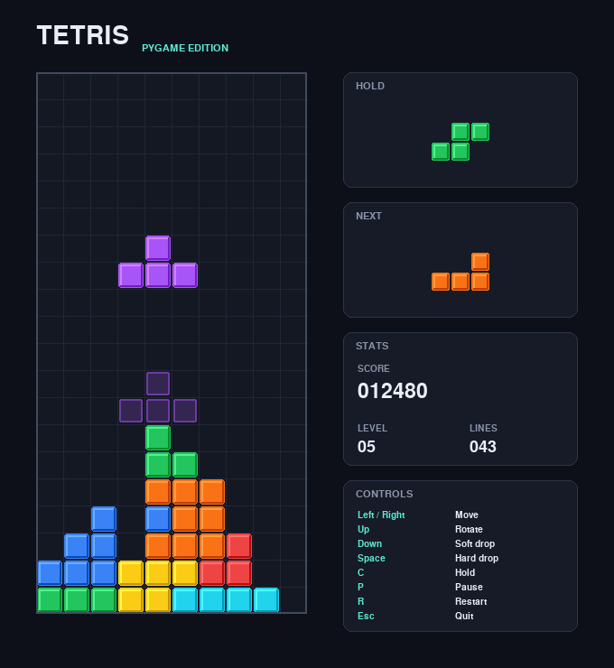
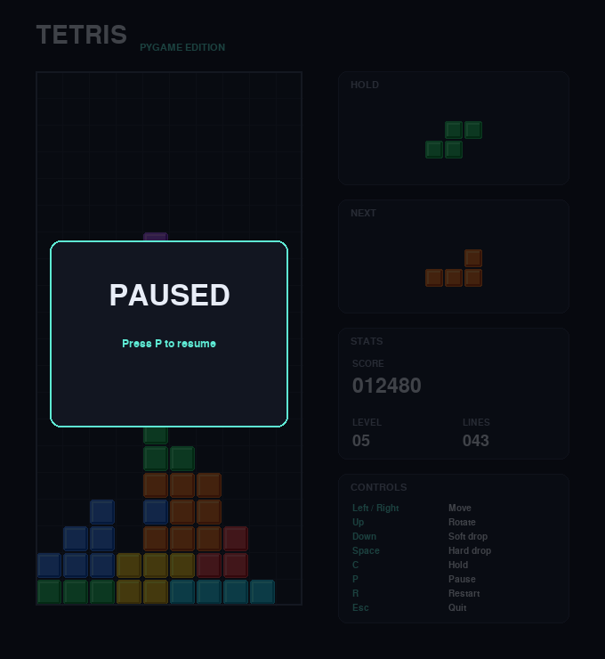
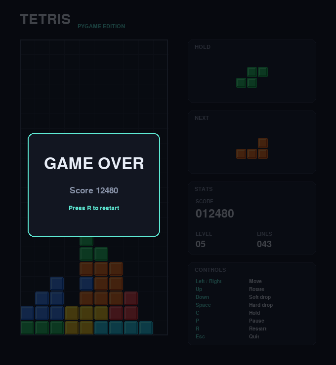

# Tetris — Python + Pygame

A complete, classic Tetris game with a headless game-rules layer, a Pygame
presentation layer, and an automated test suite.



## Features

- All seven tetrominoes (I, O, T, S, Z, J, L) on a 10 × 20 playfield.
- Seven-bag randomizer, next-piece preview, and one hold piece per spawned piece.
- SRS rotation with wall kicks, soft drop, hard drop, and a translucent ghost piece.
- Line clearing with standard scoring, level progression, and a gravity curve that
  speeds up as the level rises.
- Pause/resume, game over, and restart.
- Clear side panel with score, level, lines, hold, next, and the full control list.
- Distinct color per piece and a simple, polished dark theme.
- Game logic is independent of Pygame and is fully tested without opening a window.

## Requirements

- Python 3.9 or newer
- Pygame 2.1 or newer (on Python 3.14+, `pygame-ce`, which provides the same
  `pygame` module)

## Installation

From the project root:

```bash
pip install pygame
```

or install the pinned requirements file:

```bash
python -m pip install -r requirements.txt
```

On Python 3.14 or newer, upstream pygame has no wheels and the source build fails.
`requirements.txt` installs `pygame-ce` for those versions instead: a drop-in
replacement that provides the same `pygame` module.

If Pygame is missing, `python main.py` exits with a clear message instead of a
traceback.

## Running the game

```bash
python main.py
```

The window opens at 680 × 740. Close it or press `Esc` to quit.

## Controls

| Key | Action |
| --- | --- |
| Left / Right arrow | Move |
| Up arrow | Rotate clockwise |
| Down arrow | Soft drop |
| Space | Hard drop |
| C | Hold / swap |
| P | Pause / resume |
| R | Restart |
| Esc | Quit |

The same list is displayed in the game's control panel.

## Rules and scoring

- The board is 10 columns wide and 20 visible rows tall.
- A piece locks when it lands, after a 0.5-second lock delay. Moving or rotating
  a grounded piece restarts the delay, up to 15 times per piece.
- Clearing lines awards points using the level the clear happened at:

  | Lines cleared | Points |
  | --- | --- |
  | 1 (single) | 100 × level |
  | 2 (double) | 300 × level |
  | 3 (triple) | 500 × level |
  | 4 (tetris) | 800 × level |

- Soft drop awards 1 point per cell; hard drop awards 2 points per cell.
- The level is `1 + lines_cleared // 10`.
- Gravity interval is
  `max(MIN_GRAVITY, BASE_GRAVITY * GRAVITY_FACTOR ** (level - 1))`.
- Holding a piece stores it; the next hold is available only after the current
  piece locks. Rotating and moving pieces are ignored while paused or after
  game over.
- The game ends when a newly spawned piece cannot fit in the spawn area. Press
  `R` to start a new game.

Scoring intentionally uses the classic line/level and drop-point rules; T-spin
and combo bonuses are outside this version's scope.

## Project structure

```text
.
├── main.py                     # Entry point and missing-Pygame message
├── tetris/
│   ├── app.py                  # Pygame window, fixed-timestep loop, input
│   ├── ui.py                   # Pygame renderer and visual layout
│   ├── game.py                 # Game state, scoring, levels, timers
│   ├── board.py                # Grid, collision, locking, line clearing
│   ├── pieces.py               # Tetromino shapes and SRS wall kicks
│   ├── randomizer.py           # Seven-bag randomizer
│   ├── constants.py            # Gravity curve, scoring, timing, board size
│   └── __init__.py
├── tests/                      # Headless pytest suite
├── scripts/
│   └── capture_screenshots.py  # Renders documentation images headlessly
├── docs/screenshots/
├── requirements.txt
├── requirements-dev.txt
├── pytest.ini
└── README.md
```

## Tests

Install the test dependency and run the suite from the project root:

```bash
python -m pip install -r requirements-dev.txt
python -m pytest
```

The tests cover collision detection, wall kicks, line clearing, scoring, level
progression, the seven-bag randomizer, hold/pause/game-over behavior, and the
rule that the logic layer must not import Pygame. No test opens a window.

## Configuration

- **Gravity / speed curve and lock timing** — `tetris/constants.py`:
  `BASE_GRAVITY`, `GRAVITY_FACTOR`, `MIN_GRAVITY`, `LOCK_DELAY`,
  `MAX_LOCK_RESETS`, `LINES_PER_LEVEL`.
- **Scoring and input timing** — `tetris/constants.py`: `LINE_SCORES`,
  `SOFT_DROP_POINTS`, `HARD_DROP_POINTS`, `DAS`, `ARR`, `SOFT_DROP_REPEAT`.
- **Colors and layout** — `tetris/ui.py`: `PIECE_COLORS`, `CELL`, panel
  dimensions, and the palette constants.
- **Controls** — `tetris/app.py`, in `InputController.handle_keydown` and
  `handle_keyup`; update the on-screen list in `tetris/ui.py` (`CONTROL_LINES`)
  when changing keys.
- **SRS shapes and kicks** — `tetris/pieces.py`: `_BASE_SHAPES`, `_JLSTZ_KICKS`,
  and `_I_KICKS`.

## Architecture and timing

The rules layer (`board.py`, `pieces.py`, `randomizer.py`, `game.py`) imports no
Pygame and can be exercised in any headless environment. The presentation layer
(`ui.py`) only reads game state; `app.py` translates keyboard events into game
actions.

The main loop uses a fixed timestep of 1/60 s with an accumulator. Gravity and
the held-key repeat timers (DAS/ARR for horizontal movement, a repeat timer for
soft drop) advance on that same fixed clock. OS key repeat is disabled with
`pygame.key.set_repeat(0)`, so a single press generates exactly one `KEYDOWN`
and is never processed twice.

## Screenshots

| Gameplay | Paused | Game over |
| --- | --- | --- |
|  |  |  |

Regenerate the images without opening a window:

```bash
python scripts/capture_screenshots.py
```

The script uses SDL's dummy video driver and the same renderer as the game.

## Troubleshooting

- **`Pygame is not installed`** — run `pip install pygame` (or
  `python -m pip install -r requirements.txt`).
- **`Failed to build 'pygame'` on Python 3.14+** — upstream pygame ships no wheels
  for those versions, so pip tries a source build that fails. Install the drop-in
  fork with `pip install pygame-ce`, or use `python -m pip install -r
  requirements.txt`, which picks it automatically.
- **`Could not open a game window`** — the game needs a graphical display.
  Run it from a desktop session; a headless server does not provide one.
- **Window opens but controls do not work** — click the window to focus it, then
  use the keys listed in the control panel.
